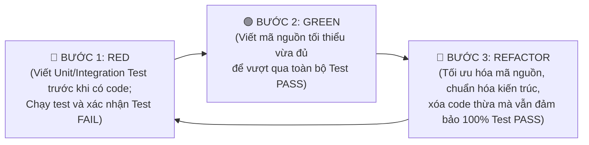

# KẾ HOẠCH TRIỂN KHAI LẬP TRÌNH THEO MÔ HÌNH TDD (TEST-DRIVEN DEVELOPMENT)
## DỰ ÁN: HỆ THỐNG QUẢN LÝ KHO HÀNG ĐIỆN MÁY THÔNG MINH - STOCK SENSE
### PHÂN HỆ: TỔNG QUAN KHO (MODULE 01: INVENTORY OVERVIEW DASHBOARD)

---

| Thông tin kế hoạch | Chi tiết |
| :--- | :--- |
| **Mã tài liệu** | `SS-IMP-MOD01-TDD-PLAN` |
| **Tên tài liệu** | Kế hoạch thực thi lập trình Module Tổng quan kho theo phương pháp TDD |
| **Phiên bản** | `1.0` |
| **Ngày lập** | 04/11/2026 |
| **Phương pháp phát triển** | **Test-Driven Development (TDD: Red $\rightarrow$ Green $\rightarrow$ Refactor)** |
| **Công nghệ mục tiêu** | Python 3.10+, Streamlit, Pytest, SQLite, Pandas, Plotly |
| **Tài liệu căn cứ** | `docs/SRS_01_Tong_Quan_Kho.md` & `docs/URD_01_Tong_Quan_Kho.md` |
| **Trạng thái** | Sẵn sàng thực thi (Ready for Execution) |

---

## 1. TỔNG QUAN PHƯƠNG PHÁP LUẬN TDD ÁP DỤNG CHO DỰ ÁN

Mô hình **Test-Driven Development (TDD)** cho Module Tổng quan kho được triển khai nghiêm ngặt theo chu trình 3 bước lặp:



### Cấu trúc thư mục mã nguồn dự kiến (Project Layout):
```text
gsj-stock-sense/
├── data/
│   ├── schema.sql                    # DDL cập nhật hỗ trợ tồn kho đa chi nhánh & giữ chỗ
│   ├── init_database.py              # Script sinh synthetic data chuẩn
│   └── kiotviet_electronics.db       # SQLite Database
├── src/
│   ├── __init__.py
│   ├── database/
│   │   ├── __init__.py
│   │   └── connection.py             # Quản lý kết nối SQLite & Pool
│   ├── services/
│   │   ├── __init__.py
│   │   ├── asset_service.py          # Nghiệp vụ US 1.1: Tính toán tài sản kho, phân quyền giá vốn
│   │   └── fulfillment_service.py    # Nghiệp vụ US 1.2: Tính toán ATP, phân loại đơn, cảnh báo treo hàng
│   └── ui/
│       ├── __init__.py
│       ├── components.py             # Các UI widgets tái sử dụng (Metric Cards, Alert Badges)
│       └── dashboard.py              # File chạy chính Streamlit Dashboard
├── tests/
│   ├── __init__.py
│   ├── conftest.py                   # Pytest fixtures: In-memory DB, Mock Data
│   ├── test_asset_service.py         # Test cases cho US 1.1
│   ├── test_fulfillment_service.py   # Test cases cho US 1.2 (ATP, Trả góp 48h, Locking)
│   └── test_ui_components.py         # Test logic format tiền tệ, data masking, filter logic
├── docs/                             # Thư mục tài liệu URD, SRS, Plan
└── pytest.ini                        # Cấu hình Pytest
```

---

## 2. KẾ HOẠCH TRIỂN KHAI CHI TIẾT THEO TỪNG GIAI ĐOẠN (SPRINT BREAKDOWN)

---

### GIAI ĐOẠN 0: CHUẨN BỊ MÔI TRƯỜNG & HẠ TẦNG DỮ LIỆU (PHASE 0: FOUNDATION)

#### 1. Thông tin chức năng:
- Nâng cấp cấu trúc Schema SQLite từ phiên bản hiện tại để đáp ứng đầy đủ các thực thể được đặc tả trong SRS: `branches`, `inventories`, `inventory_reservations`, `purchase_orders`.
- Xây dựng bộ sinh dữ liệu giả lập (Synthetic Data Generator) gồm **3 chi nhánh** (Kho Tổng, Showroom Cầu Giấy, Showroom Hà Đông), **100+ mã SKU điện máy**, các kịch bản đơn hàng thực tế (đơn trả thẳng, đơn trả góp treo > 48h, hàng đang về).

#### 2. Cách thức triển khai (How-To) theo TDD:
- **Bước Red (Viết Test trước):**
  - Tạo `tests/test_database_schema.py`:
    - `test_tables_exist()`: Kiểm tra sự tồn tại của các bảng: `branches`, `inventories`, `inventory_reservations`, `purchase_orders`.
    - `test_atp_computed_column_or_trigger()`: Kiểm tra ràng buộc $on\_hand - reserved \ge 0$.
    - `test_foreign_key_integrity()`: Chạy `PRAGMA foreign_key_check` xác nhận không có bản ghi mồ côi.
  - Chạy `pytest tests/test_database_schema.py` $\rightarrow$ **Xác nhận FAIL (Đỏ)**.
- **Bước Green (Viết Code):**
  - Cập nhật `data/schema.sql`: Bổ sung DDL cho bảng `branches`, `inventories`, `inventory_reservations`, `purchase_orders`.
  - Cập nhật `data/init_database.py`: Sinh dữ liệu seed data 100+ SP, 30+ đơn hàng mô phỏng các ca edge cases.
  - Chạy lại test $\rightarrow$ **Xác nhận PASS (Xanh)**.
- **Bước Refactor (Tối ưu):**
  - Tạo index tối ưu hóa truy vấn: `idx_inv_branch_product`, `idx_res_status_expires`.

#### 3. Definition of Done (DoD):
- [x] 100% test case trong `test_database_schema.py` đạt trạng thái **PASS**.
- [x] Database chứa tối thiểu: 3 chi nhánh, 100 sản phẩm điện máy có đầy đủ thông tin giá vốn, giá bán, danh mục 3 cấp, và có ít nhất 5 mã có đơn trả góp treo quá hạn 48h.
- [x] `PRAGMA foreign_key_check` trả về 0 lỗi.

---

### GIAI ĐOẠN 1: TDD CHO US 1.1 - TÍNH TOÁN VÀ THEO DÕI TỔNG QUAN TÀI SẢN KHO

#### 1. Thông tin chức năng:
- **UC-INV-01 & UC-INV-02:** Tính toán 3 chỉ số KPI tổng thể:
  - `Tổng số lượng sản phẩm (Total SKUs)`: Đếm số SKU active theo bộ lọc.
  - `Tổng số lượng tồn kho (Total On-Hand Units)`: Tổng số lượng chiếc thực tế.
  - `Tổng giá vốn tồn kho (Total Inventory Valuation)`: Tổng $(Qty \times CostPrice)$.
  - Tỷ lệ % biến động so với snapshot kỳ trước.
- **UC-INV-03:** Cơ chế **Bảo mật dữ liệu giá vốn (Dynamic Cost Masking)**:
  - Quyền `ROLE_OWNER` / `ROLE_STORE_MGR`: Xem đầy đủ giá trị VNĐ.
  - Quyền `ROLE_WAREHOUSE` (Thủ kho): Che giấu giá trị giá vốn (`None` hoặc `*** đ`), không gửi ra tầng hiển thị.
- **UC-INV-04:** Bảng Top 10 sản phẩm chiếm vốn cao nhất và cơ cấu giá vốn theo ngành hàng.

#### 2. Cách thức triển khai (How-To) theo TDD:
- **Bước Red (Viết Test trước):**
  - Tạo `tests/test_asset_service.py`:
    - `test_calculate_kpi_summary_all_branches()`: Xác minh công thức tính tổng SKU, số lượng chiếc, tổng giá vốn khi chọn tất cả chi nhánh.
    - `test_calculate_kpi_summary_filtered_by_category()`: Xác minh lọc theo danh mục (ví dụ chỉ lấy "Điện lạnh").
    - `test_cost_masking_for_warehouse_role()`: Gọi hàm lấy KPI với vai trò `ROLE_WAREHOUSE` $\rightarrow$ Xác nhận trường `total_valuation` trả về `None`, trường `is_masked` bằng `True`.
    - `test_cost_visible_for_owner_role()`: Gọi hàm với vai trò `ROLE_OWNER` $\rightarrow$ Xác nhận trường `total_valuation` trả về đúng số tiền thực tế, `is_masked` bằng `False`.
    - `test_top_10_capital_tied_products()`: Xác minh trả về đúng 10 sản phẩm có giá trị vốn tồn kho lớn nhất theo thứ tự giảm dần.
  - Chạy `pytest tests/test_asset_service.py` $\rightarrow$ **Xác nhận FAIL (Đỏ)** vì chưa có `src/services/asset_service.py`.
- **Bước Green (Viết Code):**
  - Tạo file `src/services/asset_service.py`:
    - Viết hàm `get_kpi_summary(branch_id, category_id, role)`: Sử dụng SQL Aggregations (`COUNT`, `SUM`) kết hợp điều kiện lọc và logic gán `total_valuation = None` nếu `role == 'ROLE_WAREHOUSE'`.
    - Viết hàm `get_top_capital_products(branch_id, limit=10)`: Query sắp xếp theo `(on_hand_qty * cost_price) DESC`.
    - Viết hàm `get_category_allocation(branch_id)`: Group by danh mục cấp 1 để vẽ đồ thị Donut/Treemap.
  - Chạy lại test $\rightarrow$ **Xác nhận PASS (Xanh)**.
- **Bước Refactor (Tối ưu):**
  - Chuyển đổi các câu lệnh query thành các hàm tối ưu, tránh N+1 query.
  - Định dạng kiểu dữ liệu trả về theo Data Classes hoặc Dict có type hinting chuẩn mực (`typing.Dict`, `typing.Optional`).

#### 3. Definition of Done (DoD):
- [ ] Toàn bộ 5 test case trong `test_asset_service.py` **PASS 100%**.
- [ ] Bảo mật giá vốn được kiểm soát chặt chẽ ở tầng service, không có kẽ hở dữ liệu cho vai trò Thủ kho.
- [ ] Code coverage của `asset_service.py` đạt $\ge 95\%$.

---

### GIAI ĐOẠN 2: TDD CHO US 1.2 - ENGINE TÍNH HÀNG KHẢ DỤNG (ATP) & KIỂM SOÁT ĐƠN HÀNG

#### 1. Thông tin chức năng:
- **UC-INV-05:** Cài đặt Engine tính toán Hàng khả dụng (Available-to-Promise - ATP):
  $$\text{ATP} = \text{on\_hand\_qty} - \text{reserved\_qty}$$
  $$\text{Projected} = \text{ATP} + \text{in\_transit\_qty}$$
- **UC-INV-06:** Cơ chế khóa giữ hàng chống bán hàng ảo:
  - Nếu số lượng đặt $\le \text{ATP}$: Cho phép giữ hàng, tăng `reserved_qty`, giảm `atp_qty`.
  - Nếu số lượng đặt $> \text{ATP}$: Chặn giao dịch, ném lỗi `InsufficientATPError`.
- **UC-INV-07:** Phân loại đơn hàng:
  - Tách bạch giữa `FULL_HOLD` (trả thẳng/COD) và `INSTALLMENT_HOLD` (trả góp).
- **UC-INV-08:** Logic tự động giải phóng hàng trả góp quá hạn 48 giờ (Auto-Release Worker):
  - Tìm tất cả bản ghi giữ chỗ trả góp có `created_at + 48 hours < CURRENT_TIMESTAMP` và trạng thái `ACTIVE`.
  - Hủy giữ chỗ, hoàn trả số lượng vào `atp_qty`, cập nhật đơn hàng thành `EXPIRED_HOLD`.
- **UC-INV-09:** Theo dõi hàng đang về từ đơn đặt hàng nhà cung cấp (`in_transit_qty`).

#### 2. Cách thức triển khai (How-To) theo TDD:
- **Bước Red (Viết Test trước):**
  - Tạo `tests/test_fulfillment_service.py`:
    - `test_atp_calculation_formula()`: Kiểm tra $\text{ATP} = \text{On-Hand} - \text{Reserved}$.
    - `test_reserve_stock_success_when_atp_sufficient()`: Tạo yêu cầu giữ 2 chiếc khi ATP = 5 $\rightarrow$ Xác nhận giữ thành công, ATP còn lại 3, tạo bản ghi `inventory_reservations`.
    - `test_reserve_stock_fail_when_atp_insufficient()`: Tạo yêu cầu giữ 6 chiếc khi ATP = 5 $\rightarrow$ Xác nhận bắt ngoại lệ `InsufficientATPError`, số lượng tồn kho không bị thay đổi.
    - `test_split_reserved_full_vs_installment()`: Kiểm tra hàm thống kê bóc tách số lượng giữ trả thẳng vs trả góp.
    - `test_auto_release_expired_installment_reservations()`: Giả lập thời gian (time freeze hoặc inject bản ghi tạo cách đây 49 tiếng) $\rightarrow$ Gọi hàm release worker $\rightarrow$ Xác nhận bản ghi chuyển thành `RELEASED`, số lượng ATP được hoàn trả nguyên vẹn.
    - `test_in_transit_stock_impact()`: Xác minh hàng đang về cộng đúng vào chỉ số `projected_stock`.
  - Chạy `pytest tests/test_fulfillment_service.py` $\rightarrow$ **Xác nhận FAIL (Đỏ)**.
- **Bước Green (Viết Code):**
  - Tạo file `src/services/fulfillment_service.py`:
    - Cài đặt class ngoại lệ `InsufficientATPError`.
    - Viết hàm `get_fulfillment_kpi(branch_id)`: Trả về các chỉ số: tổng giữ chỗ, giữ trả góp, giữ trả thẳng, tồn khả dụng, hàng đang về.
    - Viết hàm `reserve_stock(order_id, branch_id, product_id, quantity, reservation_type)` sử dụng DB transaction khóa bản ghi.
    - Viết hàm `release_expired_installment_reservations()`: Quét và cập nhật trạng thái các đơn quá hạn 48h.
    - Viết hàm `get_stock_status_table(branch_id, filter_status)`: Trả về danh sách chi tiết các mặt hàng kèm cờ trạng thái (`HẾT KHẢ DỤNG`, `TREO TRẢ GÓP`, `ĐANG VỀ`).
  - Chạy lại test $\rightarrow$ **Xác nhận PASS (Xanh)**.
- **Bước Refactor (Tối ưu):**
  - Đóng gói Database transaction bằng context manager (`with transaction(): ...`) để đảm bảo rollback tuyệt đối khi có lỗi.

#### 3. Definition of Done (DoD):
- [ ] Toàn bộ 6 test case trong `test_fulfillment_service.py` **PASS 100%**.
- [ ] Cơ chế chống bán hàng ảo ngăn chặn 100% tình trạng âm kho trong các test case đặt quá số lượng khả dụng.
- [ ] Test case mô phỏng đơn trả góp 48h tự động giải phóng hàng chính xác đến từng đơn vị sản phẩm.
- [ ] Code coverage của `fulfillment_service.py` đạt $\ge 95\%$.

---

### GIAI ĐOẠN 3: LẬP TRÌNH GIAO DIỆN STREAMLIT DASHBOARD (UI INTEGRATION)

#### 1. Thông tin chức năng:
- Xây dựng giao diện Streamlit Dashboard chuẩn quy tắc 3 phút ra quyết định:
  - **Thanh bên (Sidebar):**
    - Bộ chọn vai trò người dùng (Giám đốc/Quản lý vs Thủ kho) để kiểm thử trực quan tính năng che giá vốn.
    - Bộ lọc đa chiều: Chi nhánh (Kho), Nhóm danh mục ngành hàng, Thương hiệu.
  - **Khối 1 (Phút 1 - Tài sản kho):** 3 Thẻ Metric Cards (Tổng SKU, Tổng số lượng chiếc, Tổng giá vốn) kèm chỉ số biến động delta xanh/đỏ.
  - **Khối 2 (Phút 2 - Điểm nghẽn đơn & ATP):** 4 Thẻ trạng thái (Tồn khả dụng ATP, Tổng hàng giữ chỗ, Hàng trả góp treo > 48h cần xử lý, Hàng đang về).
  - **Khối 3 (Phút 3 - Tác chiến ra quyết định):**
    - Biểu đồ Donut/Treemap phân bổ vốn theo ngành hàng.
    - Bảng cảnh báo hàng hóa cần lưu ý (có badge màu sắc cảnh báo: Đỏ cho Hết hàng khả dụng, Vàng cho Treo trả góp > 48h).
    - Nút bấm mô phỏng: *"Giải phóng đơn trả góp quá hạn"* $\rightarrow$ Bấm vào gọi worker và cập nhật số liệu ngay lập tức.

#### 2. Cách thức triển khai (How-To) theo TDD:
- **Bước Red (Viết Test trước cho UI Helper / Formatter):**
  - Tạo `tests/test_ui_components.py`:
    - `test_format_currency_vnd()`: Kiểm tra định dạng tiền tệ `15820500000` $\rightarrow$ `"15,820,500,000 đ"`.
    - `test_format_masked_currency()`: Kiểm tra khi `is_masked=True` $\rightarrow$ Trả về `"*** đ (Bảo mật)"`.
    - `test_status_badge_mapping()`: Kiểm tra phân loại trạng thái sản phẩm ra đúng mã màu UI (Đỏ/Vàng/Xanh).
  - Chạy `pytest tests/test_ui_components.py` $\rightarrow$ **Xác nhận FAIL (Đỏ)**.
- **Bước Green (Viết Code):**
  - Viết `src/ui/components.py` chứa các hàm format tiền tệ, render HTML badge, cấu hình layout Streamlit.
  - Chạy lại test component $\rightarrow$ **Xác nhận PASS (Xanh)**.
  - Viết `src/ui/dashboard.py` (hoặc `app.py` tại root):
    - Tích hợp gọi `AssetService` và `FulfillmentService`.
    - Sử dụng `@st.cache_data(ttl=60)` để tăng tốc độ tải.
    - Vẽ đồ thị bằng Plotly (`plotly.graph_objects`, `plotly.express`).
- **Bước Refactor (Tối ưu):**
  - Bố trí CSS gọn gàng, hỗ trợ hiển thị tối ưu trên màn hình độ phân giải từ 1366px trở lên.

#### 3. Definition of Done (DoD):
- [ ] 100% test case trong `test_ui_components.py` **PASS**.
- [ ] Màn hình Streamlit khởi chạy không có bất kỳ Warning/Traceback error nào (`streamlit run app.py`).
- [ ] Chuyển đổi vai trò sang "Thủ kho" $\rightarrow$ Thẻ giá vốn lập tức được che giấu (`*** đ`).
- [ ] Thời gian tải trang ban đầu $\le 1.2$ giây; thời gian đổi bộ lọc $\le 0.4$ giây.

---

### GIAI ĐOẠN 4: KIỂM THỬ TỔNG THỂ, HIỆU NĂNG & ĐÓNG GÓI BÀN GIAO

#### 1. Thông tin chức năng:
- Chạy toàn bộ Test Suite (End-to-End Regression Test).
- Kiểm tra hiệu năng tải trang và khả năng mở rộng.
- Viết tài liệu hướng dẫn chạy ứng dụng (`README.md` hoặc tài liệu hướng dẫn kiểm thử).

#### 2. Cách thức triển khai (How-To):
- Chạy lệnh kiểm thử toàn diện:
  ```bash
  pytest --cov=src --cov-report=term-missing tests/
  ```
- Kiểm tra tổng thể các kịch bản người dùng (User Scenarios):
  - Kịch bản 1: Giám đốc mở trang, lọc theo Showroom Cầu Giấy, phát hiện 3 mã hàng bị treo trả góp > 48h, bấm nút giải phóng kho $\rightarrow$ ATP tăng ngay lập tức.
  - Kịch bản 2: Thủ kho đăng nhập, xem số lượng chiếc và số lượng hàng đang về để sắp xếp giá kệ, không nhìn thấy giá vốn.

#### 3. Definition of Done (DoD Tổng thể cho Module):
- [ ] Độ phủ kiểm thử (Test Coverage) toàn dự án đạt tối thiểu **$\ge 90\%$**.
- [ ] Tất cả các tiêu chí trong bảng Acceptance Criteria của URD và SRS đều được thỏa mãn.
- [ ] File hướng dẫn khởi chạy ứng dụng rõ ràng, chạy được bằng 1 lệnh duy nhất (`streamlit run app.py`).

---

## 3. BẢNG TIẾN ĐỘ THỜI GIAN & MA TRẬN PHÂN CÔNG (TIMELINE & EFFORT)

| Bước | Hạng mục công việc (Work Items) | Thời gian ước lượng | Người phụ trách | Trạng thái |
| :---: | :--- | :---: | :--- | :---: |
| **P0** | Nâng cấp Schema SQLite & Bộ sinh Synthetic Data (TDD) | 1 ngày | Backend / Data Dev | **HOÀN THÀNH (100% Tests Pass)** |
| **P1** | Lập trình Service US 1.1: Tài sản kho & Bảo mật giá vốn (TDD) | 1.5 ngày | Backend Dev | Đang tiến hành |
| **P2** | Lập trình Service US 1.2: ATP Engine & Giữ hàng trả góp 48h (TDD) | 2 ngày | Backend Dev | Sẵn sàng |
| **P3** | Lập trình Streamlit Dashboard UI & Kết nối Services | 1.5 ngày | Frontend / Streamlit Dev | Sẵn sàng |
| **P4** | Tối ưu hóa hiệu năng, Caching, Regression Test & Bàn giao | 1 ngày | QA / Lead Dev | Sẵn sàng |
| **TỔNG** | **Toàn bộ Module 01: Tổng quan kho** | **7 ngày làm việc** | **Team dự án** | - |

---

*Kế hoạch lập trình TDD được thiết kế và phê duyệt kỹ thuật bởi Technical Lead & BA Team - Dự án Stock Sense.*
