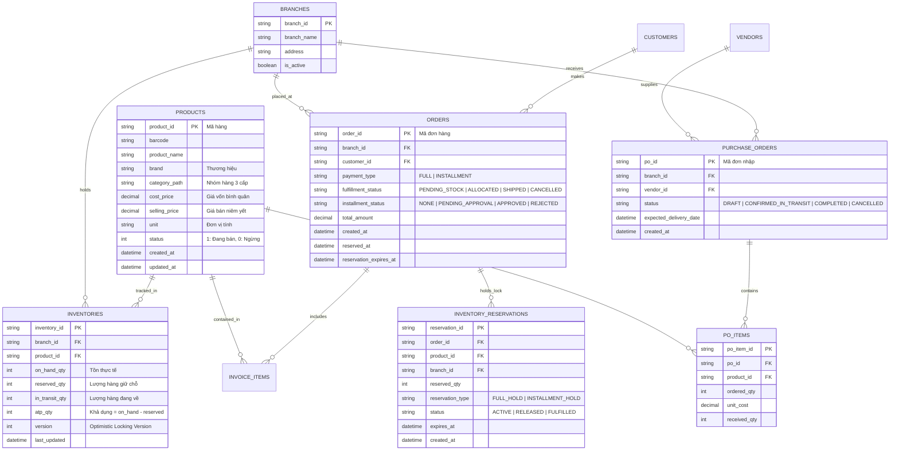
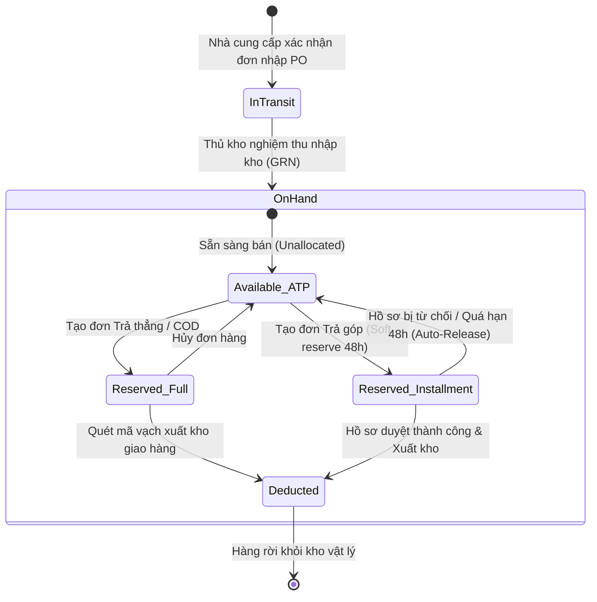

# TÀI LIỆU ĐẶC TẢ YÊU CẦU PHẦN MỀM (SOFTWARE REQUIREMENTS SPECIFICATION - SRS)
## DỰ ÁN: HỆ THỐNG QUẢN LÝ KHO HÀNG ĐIỆN MÁY THÔNG MINH - STOCK SENSE
### PHÂN HỆ: TỔNG QUAN KHO (MODULE 01: INVENTORY OVERVIEW)

---

| Thông tin tài liệu | Chi tiết |
| :--- | :--- |
| **Mã tài liệu** | `SS-SRS-MOD01-INVENTORY-OVERVIEW` |
| **Tên tài liệu** | Đặc tả yêu cầu phần mềm - Phân hệ Tổng quan kho |
| **Phiên bản** | `1.0` |
| **Ngày ban hành** | 21/10/2026 |
| **Tác giả** | Đội ngũ Phân tích Nghiệp vụ & Kỹ thuật (Technical BA Team) |
| **Tài liệu căn cứ** | `docs/URD_01_Tong_Quan_Kho.md`, `docs/01_DATA_STRUCTURE_ANALYSIS.md`, `docs/user-stories-documents.md` |
| **Tiêu chuẩn áp dụng** | ISO/IEC/IEEE 29148:2018 & IEEE 830-1998 |
| **Trạng thái** | Phê duyệt thực thi (Approved for Implementation) |
| **Đối tượng tiếp nhận** | Tech Lead, Backend Developers, Frontend Developers, QA/QC Engineers, System Architects |

---

## 1. TỔNG QUAN HỆ THỐNG & PHẠM VI KỸ THUẬT (SYSTEM OVERVIEW & SCOPE)

### 1.1. Mục đích tài liệu
Tài liệu SRS này đặc tả chi tiết các yêu cầu kỹ thuật, mô hình dữ liệu, hành vi nghiệp vụ thuật toán, giao diện người dùng và hợp đồng giao tiếp API của **Phân hệ Tổng quan kho (Module 01)** thuộc hệ thống **Stock Sense**. Tài liệu đóng vai trò là "Single Source of Truth" (Nguồn chân lý duy nhất) phục vụ:
- **Backend Developers:** Thiết kế cơ sở dữ liệu, cài đặt logic nghiệp vụ (Business Logic Engines), cơ chế khóa dữ liệu (Concurrency Locking) và xây dựng RESTful APIs.
- **Frontend Developers:** Xây dựng giao diện Dashboard, tích hợp API, xử lý trạng thái giao diện (UI State Management) và phân quyền hiển thị dữ liệu động (Dynamic Data Masking).
- **QA/QC Engineers:** Thiết kế kịch bản kiểm thử (Test Plan, Test Cases, Automation API Tests) và xác thực nghiệm thu tính năng.

### 1.2. Phạm vi module (Scope of Work)

#### Trong phạm vi (In-Scope):
1. **Dịch vụ tổng hợp tài sản kho (US 1.1):** Truy vấn, tổng hợp và hiển thị các chỉ số KPI: Tổng số mã sản phẩm (SKUs), Tổng số lượng tồn kho vật lý (On-hand Units), Tổng giá vốn tồn kho (Total Inventory Valuation).
2. **Bộ lọc đa chiều thời gian thực (Multi-dimensional Filters):** Lọc theo Chi nhánh/Kho, Cây danh mục nhóm hàng (3 cấp), và mốc thời gian.
3. **Phân quyền bảo mật dữ liệu giá vốn (Dynamic Cost Masking):** Ẩn triệt để thông tin giá vốn ở tầng API và tầng UI đối với vai trò Thủ kho (`ROLE_WAREHOUSE`).
4. **Engine tính toán Hàng khả dụng (US 1.2 - ATP Engine):** Tính toán chính xác $\text{ATP} = \text{On-Hand} - \text{Reserved}$ và $\text{Projected} = \text{ATP} + \text{In-Transit}$.
5. **Cơ chế khóa giữ hàng chống bán hàng ảo (Anti-Phantom Stock Mechanism):** Khóa bản ghi (Pessimistic/Optimistic Lock) khi tạo đơn, ngăn chặn tình trạng âm kho hoặc hứa bán vượt quá lượng hàng có thật.
6. **Theo dõi & Phân loại đơn hàng:** Phân loại theo hình thức thanh toán (Trả góp vs Thanh toán toàn phần/COD) và cảnh báo đơn hàng bị treo giữ chỗ.
7. **Bộ tiến trình chạy ngầm tự động giải phóng hàng (Auto-Release Worker):** Quét định kỳ và tự động hủy giữ chỗ các đơn trả góp bị quá hạn thẩm định 48 giờ.
8. **Theo dõi dòng hàng đang nhập về (In-Transit PO Tracking):** Tổng hợp số lượng hàng đã ký đơn nhập với Nhà cung cấp (PO) đang trên đường vận chuyển.

#### Ngoài phạm vi (Out-of-Scope của Module 01):
- Thao tác quét mã vạch kiểm kê kho vật lý chi tiết từng Serial/IMEI tại giá kệ (thuộc Module Quản lý kho chi tiết).
- Thuật toán gợi ý danh sách xả hàng và gợi ý kịch bản giá (thuộc Module 02 & Module 03).
- Xử lý giao dịch thanh toán trực tuyến qua cổng thanh toán VNPay/MoMo/Ngân hàng (thuộc Module Thanh toán).

### 1.3. Bảng thuật ngữ kỹ thuật (Glossary & Abbreviations)

| Thuật ngữ | Tên đầy đủ | Giải thích kỹ thuật |
| :--- | :--- | :--- |
| **SKU** | Stock Keeping Unit | Mã định danh quản lý hàng hóa độc lập của từng sản phẩm. |
| **On-Hand** | Physical On-Hand Stock | Lượng hàng vật lý thực tế đang nằm trong kho (đã nhập kho thành công). |
| **Reserved** | Committed / Allocated Stock | Lượng hàng đã được gắn với các đơn hàng bán nhưng chưa xuất kho vật lý. |
| **ATP** | Available-to-Promise | Lượng hàng tồn khả dụng tối đa được phép xác nhận bán giao ngay cho khách hàng mới. |
| **In-Transit** | Inbound PO Stock | Lượng hàng đã duyệt Đơn nhập hàng (Purchase Order) với NCC và đang trên đường vận chuyển. |
| **Projected** | Projected / Expected Stock | Tổng năng lực đáp ứng hàng trong tương lai gần ($\text{ATP} + \text{In-Transit}$). |
| **Soft Reserve** | Temporary Inventory Hold | Cơ chế tạm giữ hàng có điều kiện về thời gian (áp dụng cho đơn trả góp chờ duyệt). |
| **Race Condition** | Hiện tượng tranh chấp dữ liệu | Xảy ra khi 2 giao dịch đồng thời cố gắng cập nhật/giữ cùng 1 số lượng tồn kho tại cùng một mili-giây. |
| **RTM** | Requirement Traceability Matrix | Ma trận truy vết yêu cầu từ URD $\rightarrow$ SRS $\rightarrow$ Code $\rightarrow$ Test Cases. |

---

## 2. MÔ HÌNH KIẾN TRÚC & DỮ LIỆU (DATA ARCHITECTURE & SCHEMA)

### 2.1. Sơ đồ thực thể liên kết (Entity-Relationship Diagram - ERD)



### 2.2. Từ điển dữ liệu kỹ thuật (Data Dictionary)

#### Bảng: `inventories` (Quản lý trạng thái tồn kho từng chi nhánh)
| Tên cột | Kiểu dữ liệu | Ràng buộc | Giá trị mặc định | Giải thích nghiệp vụ kỹ thuật |
| :--- | :--- | :--- | :--- | :--- |
| `inventory_id` | `VARCHAR(64)` | PK, NOT NULL | `UUID()` | Định danh duy nhất cho bản ghi tồn kho chi nhánh. |
| `branch_id` | `VARCHAR(32)` | FK $\rightarrow$ `branches.branch_id`, NOT NULL | - | Mã chi nhánh / kho hàng. Index `idx_inv_branch`. |
| `product_id` | `VARCHAR(32)` | FK $\rightarrow$ `products.product_id`, NOT NULL | - | Mã hàng. Index `idx_inv_product`. |
| `on_hand_qty` | `INT` | NOT NULL, CHECK $\ge 0$ | `0` | Số lượng tồn kho vật lý thực tế tại kho. |
| `reserved_qty` | `INT` | NOT NULL, CHECK $\ge 0$ | `0` | Tổng lượng hàng đang bị khóa giữ cho các đơn chưa xuất. |
| `in_transit_qty` | `INT` | NOT NULL, CHECK $\ge 0$ | `0` | Tổng lượng hàng đang về từ các PO trạng thái `CONFIRMED_IN_TRANSIT`. |
| `atp_qty` | `INT` | NOT NULL (Computed / Stored) | `0` | Tồn khả dụng = `on_hand_qty - reserved_qty`. Luôn được cập nhật đồng bộ. |
| `version` | `INT` | NOT NULL | `1` | Dùng cho Optimistic Locking kiểm soát race condition. |
| `last_updated` | `TIMESTAMP` | NOT NULL | `CURRENT_TIMESTAMP` | Thời điểm cập nhật biến động kho gần nhất. |

*Unique Constraint:* `UNIQUE KEY uq_branch_product (branch_id, product_id)`

#### Bảng: `inventory_reservations` (Chi tiết khóa giữ kho theo đơn)
| Tên cột | Kiểu dữ liệu | Ràng buộc | Giá trị mặc định | Giải thích nghiệp vụ kỹ thuật |
| :--- | :--- | :--- | :--- | :--- |
| `reservation_id` | `VARCHAR(64)` | PK, NOT NULL | `UUID()` | Mã phiên giữ chỗ. |
| `order_id` | `VARCHAR(32)` | FK $\rightarrow$ `orders.order_id`, NOT NULL | - | Mã đơn hàng giữ kho. |
| `product_id` | `VARCHAR(32)` | FK $\rightarrow$ `products.product_id`, NOT NULL | - | Mã sản phẩm được giữ. |
| `branch_id` | `VARCHAR(32)` | FK $\rightarrow$ `branches.branch_id`, NOT NULL | - | Chi nhánh xuất kho. |
| `reserved_qty` | `INT` | NOT NULL, CHECK $> 0$ | `1` | Số lượng sản phẩm giữ chỗ. |
| `reservation_type` | `VARCHAR(20)` | NOT NULL | `'FULL_HOLD'` | Enum: `FULL_HOLD` (trả thẳng/COD), `INSTALLMENT_HOLD` (trả góp). |
| `status` | `VARCHAR(20)` | NOT NULL | `'ACTIVE'` | Enum: `ACTIVE` (đang giữ), `RELEASED` (đã hủy/hết hạn), `FULFILLED` (đã xuất kho). |
| `expires_at` | `TIMESTAMP` | NULL | - | Hạn chót giữ hàng. Nếu `INSTALLMENT_HOLD`: `created_at + INTERVAL 48 HOUR`. |
| `created_at` | `TIMESTAMP` | NOT NULL | `CURRENT_TIMESTAMP` | Thời điểm tạo lệnh giữ hàng. |

### 2.3. Máy trạng thái vòng đời tồn kho (Stock Lifecycle State Machine)



---

## 3. ĐẶC TẢ CHI TIẾT YÊU CẦU CHỨC NĂNG (FUNCTIONAL SPECIFICATIONS)

### 3.1. Phân hệ US 1.1: Tổng hợp & Theo dõi Tài sản kho

#### REQ-SRS-INV-01: Bộ lọc dữ liệu đa chiều (Multi-Dimensional Filtering)
- **Mô tả:** Hệ thống cung cấp thanh công cụ lọc dữ liệu tại góc trên cùng của Dashboard.
- **Dữ liệu đầu vào (Input Parameters):**
  - `branch_id`: Chuỗi (Mặc định: Chi nhánh người dùng trực thuộc; nếu là `ROLE_OWNER` mặc định `ALL`).
  - `category_id`: Chuỗi định danh danh mục (Cây phân cấp 3 cấp: Ngành hàng $\rightarrow$ Nhóm $\rightarrow$ Phân loại; Mặc định `ALL`).
  - `brand`: Chuỗi thương hiệu (VD: `Samsung`, `Panasonic`, `LG`...; Mặc định `ALL`).
  - `as_of_date`: Ngày chốt dữ liệu (Mặc định: `CURRENT_DATE` - Thời gian thực).
- **Hành vi hệ thống:**
  1. Khi người dùng thay đổi bất kỳ bộ lọc nào, Frontend kích hoạt cơ chế `Debounce (300ms)` trước khi gửi request về Backend.
  2. Backend nhận tham số, tự động validate quyền truy cập chi nhánh của User Token (JWT). Nếu user không có quyền trên `branch_id` yêu cầu $\rightarrow$ Trả về mã lỗi `HTTP 403 Forbidden`.
  3. Cập nhật lại toàn bộ các thẻ KPI và biểu đồ trên giao diện mà không cần reload lại toàn trang.

#### REQ-SRS-INV-02: Tính toán & Hiển thị Thẻ KPI Tài sản kho (Asset Metric Engine)
- **Mô tả:** Tính toán tức thời 3 chỉ số tổng quan tài sản kho dựa theo phạm vi bộ lọc đã chọn.
- **Công thức tính toán kỹ thuật:**
  1. **Tổng số lượng sản phẩm (Total Active SKUs):**
     $$\text{Total\_SKUs} = \text{COUNT}(\text{DISTINCT } p.product\_id) \quad \text{WHERE } p.status = 1 \text{ AND } inv.branch\_id = :branch\_id$$
  2. **Tổng số lượng tồn kho vật lý (Total Physical On-Hand Units):**
     $$\text{Total\_OnHand\_Units} = \sum inv.on\_hand\_qty$$
  3. **Tổng giá vốn tồn kho (Total Inventory Valuation):**
     $$\text{Total\_Valuation} = \sum (inv.on\_hand\_qty \times p.cost\_price)$$
- **Biến động so với kỳ trước (Trend Percentage):**
  - So sánh với giá trị snapshot lưu lúc `00:00:00` của ngày đầu tuần hoặc ngày đầu tháng:
    $$\Delta\% = \frac{\text{Current\_Value} - \text{Previous\_Snapshot}}{\text{Previous\_Snapshot}} \times 100$$
  - Nếu `Previous_Snapshot == 0`: Hiển thị `+100%` (nếu tăng) hoặc `0%`.

#### REQ-SRS-INV-03: Bảo mật & Che giấu dữ liệu Giá vốn động (Dynamic Cost Masking)
- **Mô tả:** Đảm bảo nguyên tắc bảo mật thông tin chi phí kinh doanh đối với các tài khoản không có thẩm quyền.
- **Quy tắc kỹ thuật:**
  - Đối với vai trò: `ROLE_OWNER`, `ROLE_STORE_MGR` $\rightarrow$ Cho phép xem đầy đủ trường `total_valuation`, `cost_price`.
  - Đối với vai trò: `ROLE_WAREHOUSE`, `ROLE_SALES` $\rightarrow$
    1. **Tầng Backend:** Middleware phân quyền (Role-based interceptor) tự động loại bỏ (strip) trường `cost_price` và `total_valuation` khỏi JSON payload trước khi gửi ra network.
    2. **Tầng Frontend:** Giao diện ẩn hoàn toàn thẻ `Tổng giá vốn tồn kho` hoặc hiển thị component dạng placeholder `Chỉ dành cho Quản lý`. Biểu đồ cơ cấu vốn tự động chuyển đổi sang biểu đồ cơ cấu theo `Số lượng tồn (Quantity Breakdown)`.

#### REQ-SRS-INV-04: Biểu đồ phân bổ vốn & Danh sách Top sản phẩm đọng vốn
- **Mô tả:** Trực quan hóa cấu trúc tài sản kho nhằm phát hiện sớm nguy cơ đọng vốn.
- **Quy cách hiển thị:**
  1. **Biểu đồ cơ cấu danh mục (Category Valuation Chart):**
     - Loại biểu đồ: Donut Chart / Treemap.
     - Dữ liệu: `Group by category_path (Level 1)`, hiển thị tỷ trọng % giá vốn và giá trị tuyệt đối (VNĐ).
  2. **Bảng Top 10 sản phẩm chiếm vốn cao nhất:**
     - Truy vấn lấy 10 SKU có giá trị $(inv.on\_hand\_qty \times p.cost\_price)$ lớn nhất giảm dần.
     - Cột dữ liệu: Mã SKU, Tên sản phẩm, ĐVT, Tồn thực tế, Giá vốn, Thành tiền vốn, Tỷ trọng trên tổng kho.

---

### 3.2. Phân hệ US 1.2: Quản lý Trạng thái Hàng hóa & Kiểm soát Đơn hàng

#### REQ-SRS-INV-05: Thuật toán tính toán Hàng khả dụng (ATP Engine)
- **Mô tả:** Đảm bảo tính nhất quán của số lượng hàng có thể cam kết bán, loại bỏ hoàn toàn rủi ro bán hàng ảo.
- **Công thức kỹ thuật:**
  $$\text{ATP} = \text{on\_hand\_qty} - \text{reserved\_qty}$$
  $$\text{Projected\_Stock} = \text{ATP} + \text{in\_transit\_qty}$$
- **Ràng buộc toàn vẹn (Integrity Constraints):**
  - $\text{on\_hand\_qty} \ge 0$ (Không cho phép tồn kho vật lý âm trong trạng thái vận hành chuẩn).
  - $\text{reserved\_qty} \ge 0$.
  - Nếu $\text{ATP} \le 0$: Giá trị hiển thị trên UI có nhãn `HẾT HÀNG KHẢ DỤNG` (Màu đỏ). Nút "Tạo đơn hàng giao ngay" trên POS/Sale module tự động chuyển sang trạng thái `Disabled` kèm thông báo: *"Sản phẩm đã được giữ chỗ hết cho các đơn hàng trước đó"*.

#### REQ-SRS-INV-06: Cơ chế Khóa giữ hàng đồng thời (Concurrent Inventory Reservation)
- **Mô tả:** Đảm bảo khi nhiều nhân viên cùng tạo đơn cho một sản phẩm có số lượng tồn ít (ví dụ còn đúng 1 chiếc), không bao giờ xảy ra tình trạng bán trùng (Overselling / Race Condition).
- **Thuật toán xử lý (Transaction & Locking):**
  Hệ thống sử dụng cơ chế **Pessimistic Locking (SELECT ... FOR UPDATE)** tại tầng Database trong Transaction tạo đơn:
  ```sql
  START TRANSACTION;
  
  -- 1. Khóa bản ghi tồn kho của sản phẩm tại chi nhánh đó
  SELECT on_hand_qty, reserved_qty, atp_qty 
  FROM inventories 
  WHERE branch_id = :branch_id AND product_id = :product_id 
  FOR UPDATE;
  
  -- 2. Kiểm tra điều kiện khả dụng
  IF (on_hand_qty - reserved_qty) >= :order_qty THEN
      -- Cập nhật tăng số lượng giữ chỗ
      UPDATE inventories 
      SET reserved_qty = reserved_qty + :order_qty,
          atp_qty = atp_qty - :order_qty,
          last_updated = CURRENT_TIMESTAMP
      WHERE branch_id = :branch_id AND product_id = :product_id;
      
      -- Tạo bản ghi chi tiết giữ chỗ
      INSERT INTO inventory_reservations (
          reservation_id, order_id, product_id, branch_id, 
          reserved_qty, reservation_type, status, expires_at
      ) VALUES (
          UUID(), :order_id, :product_id, :branch_id,
          :order_qty, :reservation_type, 'ACTIVE', :expires_at
      );
      
      COMMIT;
      -- Trả về: Thành công (Reserved Success)
  ELSE
      ROLLBACK;
      -- Trả về: Lỗi HTTP 409 Conflict: "Sản phẩm không đủ số lượng khả dụng"
  END IF;
  ```

#### REQ-SRS-INV-07: Phân loại & Giám sát hàng giữ chỗ theo loại đơn
- **Mô tả:** Dashboard phân tách rõ ràng lượng hàng đang giữ theo 2 nhóm:
  1. **Đơn hàng Trả thẳng / Thanh toán toàn phần (`FULL_HOLD`):**
     - Áp dụng cho đơn COD hoặc đã thanh toán 100% chờ xuất kho.
     - Thời gian giữ hàng chuẩn: Tối đa **24 giờ**.
     - Nếu đơn giữ quá 24h chưa xuất kho: Gắn cờ cảnh báo vàng `LƯU KHO QUÁ HẠN XUẤT`.
  2. **Đơn hàng Mua trả góp (`INSTALLMENT_HOLD`):**
     - Áp dụng cho đơn chờ thẩm định hồ sơ từ ngân hàng / công ty tài chính (HD SAISON, FE Credit...).
     - Thời hạn giữ hàng tối đa (`expires_at`): Chính xác **48 giờ** kể từ thời điểm tạo đơn (`created_at + 48 hours`).
     - Dashboard thống kê riêng chỉ số: `Tổng lượng hàng giữ chờ duyệt trả góp` và danh sách chi tiết các đơn trả góp đang giữ hàng.

#### REQ-SRS-INV-08: Tiến trình tự động giải phóng hàng quá hạn (Auto-Release Background Worker)
- **Mô tả:** Dịch vụ ngầm (Scheduled Cron Job) tự động hủy giữ chỗ các đơn hàng trả góp quá hạn 48 giờ để hoàn trả tồn khả dụng vào kho bán.
- **Tần suất chạy:** Mỗi **05 phút một lần** (`*/5 * * * *`).
- **Quy trình thực thi của Worker:**
  ```mermaid
  flowchart TD
      W_Start([Worker khởi chạy mỗi 5 phút]) --> Query[Tìm kiếm các bản ghi reservation thỏa mãn:<br/>status = 'ACTIVE' AND reservation_type = 'INSTALLMENT_HOLD'<br/>AND expires_at < CURRENT_TIMESTAMP]
      Query --> Check{Có bản ghi quá hạn?}
      Check -- Không --> W_End([Kết thúc chu kỳ])
      Check -- Có --> Loop[Duyệt từng bản ghi reservation]
      
      Loop --> Tx_Start[Bắt đầu Transaction]
      Tx_Start --> Lock_Inv[Khóa bản ghi inventories FOR UPDATE]
      Lock_Inv --> Upd_Inv[UPDATE inventories:<br/>reserved_qty = reserved_qty - res.reserved_qty<br/>atp_qty = atp_qty + res.reserved_qty]
      Upd_Inv --> Upd_Res[UPDATE inventory_reservations:<br/>status = 'RELEASED', updated_at = NOW]
      Upd_Res --> Upd_Order[UPDATE orders:<br/>installment_status = 'EXPIRED_HOLD',<br/>fulfillment_status = 'CANCELLED']
      Upd_Order --> Tx_Commit[COMMIT Transaction]
      
      Tx_Commit --> Log_Audit[Ghi Audit Log hệ thống]
      Log_Audit --> Push_Noti[Bắn thông báo WebSocket / SSE<br/>đến Quản lý cửa hàng & Nhân viên bán]
      Push_Noti --> Loop
  ```

#### REQ-SRS-INV-09: Theo dõi Lượng hàng đang về (In-Transit PO Tracker)
- **Mô tả:** Cập nhật và hiển thị lượng hàng đã đặt nhà cung cấp đang trên đường giao về kho chi nhánh.
- **Hành vi hệ thống:**
  1. Khi một Đơn nhập hàng (Purchase Order) chuyển trạng thái sang `CONFIRMED_IN_TRANSIT` $\rightarrow$ Tự động cộng số lượng vào trường `in_transit_qty` của bảng `inventories`.
  2. Khi Thủ kho thực hiện kiểm đếm và bấm "Xác nhận nhập kho hoàn tất" $\rightarrow$ Hệ thống tự động trừ `in_transit_qty` và cộng vào `on_hand_qty`.
  3. Trên Dashboard, người dùng có thể nhấp vào chỉ số `Hàng đang về` để xem danh sách popover gồm: Mã PO, Tên Nhà cung cấp, Số lượng sản phẩm, Ngày dự kiến về (Estimated Delivery Date - EDD).

---

## 4. ĐẶC TẢ GIAO TIẾP & HỢP ĐỒNG API (INTERFACE & API CONTRACTS)

### 4.1. Chuẩn quy ước chung (API Conventions)
- **Base URL:** `https://api.stocksense.vn/api/v1`
- **Giao thức:** HTTPS, RESTful API, JSON Payload (UTF-8).
- **Xác thực:** Bearer Token (JSON Web Token - JWT) trong Header: `Authorization: Bearer <token>`.
- **Định dạng thời gian:** Chuẩn ISO-8601 (`YYYY-MM-DDTHH:mm:ss.sssZ`).

---

### 4.2. Danh mục API Endpoints

#### 1. `GET /inventory/dashboard/kpi-summary`
Lấy số liệu 3 thẻ KPI tài sản kho và các chỉ số tóm tắt trạng thái đơn hàng.

- **Query Parameters:**
  | Tên tham số | Kiểu | Bắt buộc | Mặc định | Mô tả |
  | :--- | :--- | :---: | :--- | :--- |
  | `branch_id` | `string` | Không | `all` | Mã chi nhánh (hoặc `all` nếu là Admin/Owner). |
  | `category_id` | `string` | Không | `all` | Lọc theo mã danh mục ngành hàng. |
  | `brand` | `string` | Không | `all` | Lọc theo hãng sản xuất. |

- **Sample Request:**
  `GET /api/v1/inventory/dashboard/kpi-summary?branch_id=BR_HN_01&category_id=CAT_DIENLANH`

- **Response (200 OK) - Đối với Chủ doanh nghiệp / Quản lý (`ROLE_OWNER`):**
  ```json
  {
    "success": true,
    "timestamp": "2026-10-21T13:55:00.000Z",
    "data": {
      "asset_kpi": {
        "total_skus": {
          "value": 1248,
          "trend_percentage": 2.5,
          "trend_direction": "UP"
        },
        "total_on_hand_units": {
          "value": 4520,
          "trend_percentage": -1.8,
          "trend_direction": "DOWN"
        },
        "total_valuation": {
          "value": 15820500000,
          "currency": "VND",
          "trend_percentage": -0.5,
          "trend_direction": "DOWN",
          "is_masked": false
        }
      },
      "fulfillment_kpi": {
        "total_reserved_units": 320,
        "installment_reserved_units": 145,
        "full_payment_reserved_units": 175,
        "atp_units": 4200,
        "in_transit_units": 850,
        "stockout_risk_skus_count": 4
      }
    }
  }
  ```

- **Response (200 OK) - Đối với Thủ kho (`ROLE_WAREHOUSE` - Data Masking áp dụng):**
  ```json
  {
    "success": true,
    "timestamp": "2026-10-21T13:55:00.000Z",
    "data": {
      "asset_kpi": {
        "total_skus": {
          "value": 1248,
          "trend_percentage": 2.5,
          "trend_direction": "UP"
        },
        "total_on_hand_units": {
          "value": 4520,
          "trend_percentage": -1.8,
          "trend_direction": "DOWN"
        },
        "total_valuation": null
      },
      "fulfillment_kpi": {
        "total_reserved_units": 320,
        "installment_reserved_units": 145,
        "full_payment_reserved_units": 175,
        "atp_units": 4200,
        "in_transit_units": 850,
        "stockout_risk_skus_count": 4
      }
    }
  }
  ```

---

#### 2. `GET /inventory/dashboard/stock-status-table`
Lấy danh sách chi tiết các mặt hàng cần lưu ý theo dõi tồn kho và đơn hàng (phục vụ bảng theo dõi US 1.2).

- **Query Parameters:**
  | Tên tham số | Kiểu | Bắt buộc | Mặc định | Mô tả |
  | :--- | :--- | :---: | :--- | :--- |
  | `branch_id` | `string` | Có | - | Mã chi nhánh. |
  | `status_filter` | `string` | Không | `ALL` | `ALL` \| `LOW_ATP` \| `STOCKOUT` \| `HAS_IN_TRANSIT` |
  | `page` | `int` | Không | `1` | Số trang. |
  | `limit` | `int` | Không | `20` | Số bản ghi trên 1 trang (Max: 100). |

- **Response (200 OK):**
  ```json
  {
    "success": true,
    "pagination": {
      "current_page": 1,
      "page_size": 20,
      "total_records": 158,
      "total_pages": 8
    },
    "data": [
      {
        "product_id": "TV-SAM65",
        "barcode": "8806091823912",
        "product_name": "Smart Tivi Samsung 4K 65 inch Crystal UHD",
        "brand": "Samsung",
        "category_name": "Tivi",
        "on_hand_qty": 15,
        "reserved_qty": 12,
        "reserved_breakdown": {
          "full_payment_qty": 7,
          "installment_qty": 5
        },
        "atp_qty": 3,
        "in_transit_qty": 20,
        "earliest_edd": "2026-10-24T10:00:00.000Z",
        "status_flag": "LOW_ATP"
      }
    ]
  }
  ```

---

#### 3. `POST /inventory/reserve`
API thực hiện khóa giữ hàng khi nhân viên bán hàng tạo đơn (gọi nội bộ hoặc từ POS).

- **Headers:** `Idempotency-Key: <unique_uuid>` (Chống tạo đơn trùng khi mạng chập chờn).
- **Request Body:**
  ```json
  {
    "order_id": "ORD-20261021-0092",
    "branch_id": "BR_HN_01",
    "payment_type": "INSTALLMENT",
    "items": [
      {
        "product_id": "TV-SAM65",
        "quantity": 1
      }
    ]
  }
  ```

- **Response (201 Created) - Thành công:**
  ```json
  {
    "success": true,
    "message": "Giữ hàng thành công",
    "data": {
      "reservation_id": "RES-88219381-01",
      "order_id": "ORD-20261021-0092",
      "reservation_type": "INSTALLMENT_HOLD",
      "expires_at": "2026-10-23T13:55:00.000Z",
      "items": [
        {
          "product_id": "TV-SAM65",
          "reserved_qty": 1,
          "remaining_atp": 2
        }
      ]
    }
  }
  ```

- **Response (409 Conflict) - Khi không đủ hàng khả dụng (Chống bán hàng ảo):**
  ```json
  {
    "success": false,
    "error_code": "ERR_INSUFFICIENT_ATP",
    "message": "Sản phẩm TV-SAM65 không đủ số lượng khả dụng. Hiện khả dụng: 0, Yêu cầu: 1.",
    "details": {
      "product_id": "TV-SAM65",
      "on_hand_qty": 15,
      "reserved_qty": 15,
      "current_atp": 0,
      "requested_qty": 1
    }
  }
  ```

---

## 5. XỬ LÝ ĐỒNG THỜI & NGOẠI LỆ (CONCURRENCY & EXCEPTION HANDLING)

### 5.1. Xử lý Race Condition & Deadlock
1. **Chiến lược Deadlock Prevention:**
   - Khi một đơn hàng có nhiều sản phẩm (`items`), Backend bắt buộc phải **Sắp xếp danh sách `product_id` theo thứ tự bảng chữ cái (Alphabetical Order)** trước khi thực hiện câu lệnh `SELECT ... FOR UPDATE`.
   - *Lý do:* Đảm bảo mọi giao dịch đều khóa tài nguyên theo cùng một thứ tự, loại trừ 100% khả năng xảy ra Cyclic Deadlock giữa 2 giao dịch đồng thời.
2. **Transaction Timeout:**
   - Cấu hình `innodb_lock_wait_timeout = 5` giây. Nếu một giao dịch giữ khóa quá 5 giây mà chưa hoàn tất $\rightarrow$ Tự động ngắt và trả về lỗi `HTTP 503 Service Unavailable: "Hệ thống đang bận, vui lòng thử lại sau vài giây"`.

### 5.2. Đồng bộ ngoại tuyến & Xử lý mất kết nối KiotViet
1. **Cơ chế Webhook & Idempotency:**
   - Khi KiotViet đẩy dữ liệu hóa đơn/đơn nhập mới qua Webhook, hệ thống kiểm tra trường `invoice_id` hoặc `po_id` trong bảng `sync_logs`.
   - Nếu đã xử lý $\rightarrow$ Trả về `HTTP 200 OK` ngay lập tức mà không cộng/trừ kho lần 2.
2. **Circuit Breaker cho API KiotViet:**
   - Nếu việc đồng bộ với KiotViet bị lỗi 5 lần liên tiếp $\rightarrow$ Ngắt mạch (Open circuit), lưu giao dịch vào Dead Letter Queue (RabbitMQ / Redis Queue) và gửi cảnh báo Slack/Email đến đội ngũ kỹ thuật.

### 5.3. Xử lý Sai lệch Kiểm kê vật lý (Inventory Discrepancy)
- Nếu kết quả kiểm kê thực tế phát hiện tồn kho thực tế nhỏ hơn lượng hàng đã giữ chỗ ($\text{On-Hand} < \text{Reserved}$):
  1. Hệ thống **không được tự ý xóa giữ chỗ của khách hàng**.
  2. Bật cờ cảnh báo đỏ `CRITICAL_INVENTORY_DISCREPANCY` trên Dashboard.
  3. Gửi thông báo khẩn cấp đến Quản lý cửa hàng để chủ động điều chuyển hàng từ kho khác về bù hoặc đàm phán lại thời gian giao với khách hàng.

---

## 6. YÊU CẦU PHI CHỨC NĂNG (NON-FUNCTIONAL REQUIREMENTS - NFRs)

### 6.1. Hiệu năng & Khả năng tải (Performance & Scalability)
- **Thời gian phản hồi API:**
  - `GET /kpi-summary`: Thời gian phản hồi tầng API $\le 300\text{ms}$ (ở mức 95th percentile).
  - Tải toàn bộ Dashboard trên trình duyệt người dùng: $\le 1.5$ giây.
- **Chiến lược Caching (Redis In-Memory Cache):**
  - Dữ liệu KPI tài sản được cache trong Redis với key: `cache:dashboard:kpi:{branch_id}:{category_id}`.
  - TTL (Time-To-Live): **60 giây**.
  - Cơ chế Cache Invalidation: Khi có sự kiện `INVENTORY_RESERVED`, `PO_COMPLETED` hoặc `INVOICE_CREATED`, hệ thống chủ động xóa key cache liên quan (Write-through / Event-driven Cache Eviction).

### 6.2. An toàn & Bảo mật (Security)
- Toàn bộ kết nối bắt buộc qua SSL/TLS 1.3.
- Dữ liệu giá vốn (`cost_price`, `total_valuation`) được mã hóa khi lưu trữ trong cơ sở dữ liệu nếu có yêu cầu bảo mật tài chính cấp cao.
- **Audit Trail Logging:** Mọi hành vi làm biến động trường `reserved_qty` hoặc `on_hand_qty` đều phải ghi vào bảng `inventory_audit_logs` gồm: `user_id`, `action`, `product_id`, `qty_before`, `qty_after`, `timestamp`, `ip_address`.

---

## 7. MA TRẬN TRUY VẾT YÊU CẦU (REQUIREMENT TRACEABILITY MATRIX - RTM)

Bảng ánh xạ truy vết 1:1 từ User Stories trong URD đến các đặc tả kỹ thuật trong SRS và mã kịch bản kiểm thử:

| User Story ID (URD) | Tên chức năng URD | Mã yêu cầu kỹ thuật (SRS REQ) | Module / Thành phần kỹ thuật | API Endpoint liên quan | Mã kịch bản kiểm thử (Test Case ID) |
| :--- | :--- | :--- | :--- | :--- | :--- |
| **US 1.1** | Thống kê số lượng sản phẩm, tồn kho và giá vốn | `REQ-SRS-INV-01`<br>`REQ-SRS-INV-02` | Dashboard Aggregator Service, Redis Cache | `GET /kpi-summary` | `TC_INV_01_KPI_CALC`<br>`TC_INV_02_FILTER_MULTI` |
| **US 1.1** | Bảo mật giá vốn đối với Thủ kho | `REQ-SRS-INV-03` | RBAC Interceptor, Data Masking Pipe | `GET /kpi-summary` | `TC_INV_03_MASK_COST` |
| **US 1.1** | Cơ cấu danh mục & Top 10 sản phẩm đọng vốn | `REQ-SRS-INV-04` | Top-N Aggregation Engine, Chart Component | `GET /allocation-charts` | `TC_INV_04_TOP10_COST` |
| **US 1.2** | Tính toán hàng khả dụng (ATP) | `REQ-SRS-INV-05` | ATP Calculator Service | `GET /stock-status-table` | `TC_INV_05_ATP_FORMULA` |
| **US 1.2** | Chống bán hàng ảo & Khóa giữ hàng | `REQ-SRS-INV-06` | Reservation Engine, Pessimistic Locking | `POST /inventory/reserve` | `TC_INV_06_RACE_CONDITION`<br>`TC_INV_07_OVERSELL_BLOCK` |
| **US 1.2** | Phân loại đơn trả góp vs trả thẳng | `REQ-SRS-INV-07` | Order Classifier, Expiration Tracker | `GET /stock-status-table` | `TC_INV_08_ORDER_TYPE_SPLIT` |
| **US 1.2** | Tự động hủy giữ hàng trả góp sau 48h | `REQ-SRS-INV-08` | Auto-Release Cron Worker | Scheduled Worker | `TC_INV_09_AUTO_RELEASE_48H` |
| **US 1.2** | Theo dõi hàng đang về (In-transit) | `REQ-SRS-INV-09` | PO In-Transit Tracker | `GET /stock-status-table` | `TC_INV_10_IN_TRANSIT_SYNC` |

---
*Tài liệu được thiết kế và phê duyệt kỹ thuật bởi Technical BA Team - Dự án Stock Sense.*
