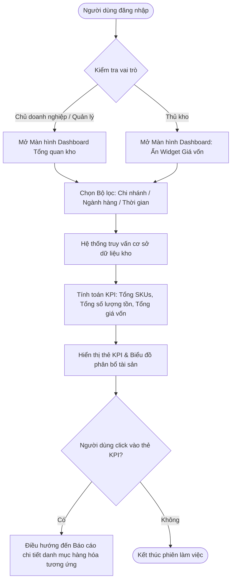
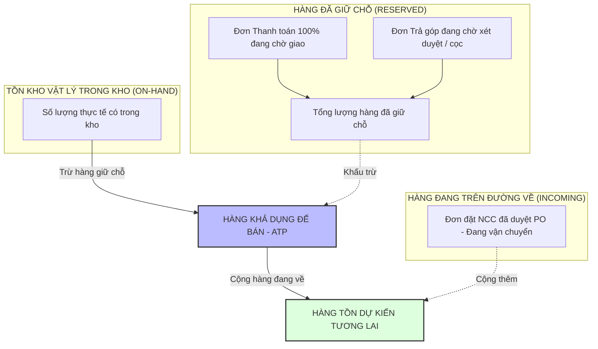

# TÀI LIỆU ĐẶC TẢ YÊU CẦU NGƯỜI SỬ DỤNG (URD)
## DỰ ÁN: HỆ THỐNG QUẢN LÝ KHO HÀNG ĐIỆN MÁY THÔNG MINH - STOCK SENSE
### PHÂN HỆ: TỔNG QUAN KHO (INVENTORY OVERVIEW DASHBOARD)

---

| Thông tin tài liệu | Chi tiết |
| :--- | :--- |
| **Mã tài liệu** | `SS-URD-MOD01-INVENTORY-OVERVIEW` |
| **Tên tài liệu** | Đặc tả yêu cầu người sử dụng - Nhóm chức năng: Tổng quan kho |
| **Phiên bản** | `1.0` |
| **Ngày tạo** | 18/10/2026 |
| **Tác giả** | Đội ngũ Phân tích Nghiệp vụ (BA Team) |
| **Tài liệu nguồn căn cứ** | `docs/user-stories-documents.md` (US 1.1, US 1.2) & `docs/01_DATA_STRUCTURE_ANALYSIS.md` |
| **Trạng thái** | Bản thảo chờ duyệt (Draft for Review) |
| **Đối tượng áp dụng** | Chủ doanh nghiệp, Quản lý cửa hàng, Thủ kho, Đội ngũ Phát triển Phần mềm (Dev/Tester) |

---

## 1. GIỚI THIỆU & MỤC TIÊU PHÂN HỆ

### 1.1. Bối cảnh dự án
Trong ngành bán lẻ điện máy (tivi, tủ lạnh, máy giặt, điều hòa, gia dụng...), giá trị từng đơn vị sản phẩm rất cao và diện tích kho bãi có hạn. Việc tồn đọng vốn lưu động do tồn kho quá mức, hoặc ngược lại là bán hứa trước cho khách nhưng trong kho không còn hàng vật lý (bán "hàng ảo"), là những rủi ro trực tiếp đe dọa dòng tiền và uy tín của doanh nghiệp.

**Stock Sense** được xây dựng nhằm giải quyết bài toán cốt lõi này bằng việc số hóa, tự động hóa và cung cấp góc nhìn thông minh toàn diện về kho hàng.

### 1.2. Mục tiêu của phân hệ "Tổng quan kho"
Phân hệ **Tổng quan kho (Inventory Overview)** là màn hình trung tâm (Command Center) đầu tiên khi người dùng đăng nhập hệ thống, nhằm đạt 3 mục tiêu chiến lược:
1. **Minh bạch hóa tài sản:** Cung cấp tức thời giá trị vốn lưu động đang nằm trong kho, tổng lượng sản phẩm theo từng danh mục.
2. **Kiểm soát hàng khả dụng & Chống bán hàng ảo:** Phân tách rõ ràng giữa *Tồn thực tế trong kho (Physical On-Hand)*, *Lượng hàng đã giữ chỗ cho đơn (Reserved/Allocated)* và *Lượng hàng đang trên đường nhập về (In-Transit)* để xác định chính xác *Lượng hàng có thể bán (Available-to-Promise - ATP)*.
3. **Phân loại rủi ro theo loại hình giao dịch:** Theo dõi các đơn hàng trả góp (vốn cần thời gian thẩm định tài chính dài hơn và nguy cơ giữ hàng ảo cao) so với đơn thanh toán toàn phần.

---

## 2. MA TRẬN VAI TRÒ & PHÂN QUYỀN (RACI MATRIX)

| Mã vai trò | Tên vai trò | Trách nhiệm chính trong phân hệ | Quyền hạn dữ liệu |
| :--- | :--- | :--- | :--- |
| **ROLE_OWNER** | Chủ doanh nghiệp / Giám đốc | Theo dõi tổng giá trị vốn lưu động, hiệu suất quay vòng vốn kho, đưa ra quyết định nhập/xả vĩ mô. | Toàn quyền xem tất cả kho/chi nhánh, xem giá vốn, giá bán, biên lợi nhuận. |
| **ROLE_STORE_MGR** | Quản lý cửa hàng | Giám sát vận hành kho của cửa hàng, cân đối lượng giữ hàng cho các đơn bán, điều phối luân chuyển. | Xem toàn bộ chỉ số kho chi nhánh phụ trách; xem giá vốn và trạng thái đơn hàng. |
| **ROLE_WAREHOUSE** | Thủ kho | Quản lý tồn kho thực tế, đối soát hàng xuất/nhập, kiểm tra tình trạng hàng giữ chỗ để soạn hàng thực tế. | Xem số lượng tồn vật lý, số lượng giữ chỗ, số lượng đang về; **không hiển thị giá vốn** (để bảo mật chi phí kinh doanh). |
| **ROLE_PURCHASING** | Nhân viên mua hàng | Theo dõi lượng hàng đang trên đường về (In-transit POs) và lượng tồn khả dụng để lập kế hoạch nhập hàng. | Xem số lượng hàng tồn, hàng đang về, nhà cung cấp dự kiến. |

---

## 3. ĐẶC TẢ CHI TIẾT USER STORY 1.1: THEO DÕI TỔNG QUAN TÀI SẢN KHO

### 3.1. User Story tóm tắt
> **Là** Quản lý cửa hàng / Chủ doanh nghiệp,  
> **Tôi muốn** xem thống kê tổng số lượng sản phẩm, tổng số lượng tồn kho và tổng giá vốn tồn kho trên một màn hình duy nhất,  
> **Để** tôi có thể nắm bắt nhanh chóng quy mô và tình hình phân bổ vốn lưu động trong kho hàng.

### 3.2. Sơ đồ quy trình nghiệp vụ (User Flow)



### 3.3. Các chỉ số đo lường (KPI Widgets) & Công thức tính toán

Hệ thống phải hiển thị 3 chỉ số cốt lõi (Metric Cards) ở vị trí trên cùng của trang:

| Mã chỉ số | Tên chỉ số hiển thị | Ý nghĩa nghiệp vụ | Nguồn dữ liệu & Công thức tính toán | Định dạng hiển thị |
| :--- | :--- | :--- | :--- | :--- |
| **KPI-1.1-A** | **Tổng số lượng sản phẩm (Total SKUs)** | Tổng số mã sản phẩm độc lập (SKU) đang được kích hoạt kinh doanh tại kho được chọn. | `COUNT(DISTINCT ProductID)`<br>Điều kiện: `Trạng thái = 1 (Đang kinh doanh)` và có quản lý kho. | Số nguyên, phân cách hàng nghìn (VD: `1,250 mã`) |
| **KPI-1.1-B** | **Tổng số lượng tồn kho (Total On-Hand Units)** | Tổng số lượng đơn vị sản phẩm vật lý hiện đang có mặt trong kho. | `SUM(Quantity_On_Hand)`<br>Với tất cả SKU hợp lệ trong kho được lọc. | Số nguyên (VD: `4,850 cái/bộ`) |
| **KPI-1.1-C** | **Tổng giá vốn tồn kho (Total Inventory Valuation)** | Tổng giá trị tài sản tính theo giá gốc (vốn lưu động) đang nằm trong kho. | $\sum (\text{Tồn kho thực tế}_i \times \text{Giá vốn}_i)$<br>*(Giá vốn áp dụng theo phương pháp Bình quân gia quyền tức thời - Moving Average Cost)* | Đơn vị tiền tệ VNĐ (VD: `12,450,000,000 đ`) |

#### Phân tích biến động (Trend Indicators):
Mỗi thẻ KPI hiển thị kèm tỷ lệ phần trăm tăng/giảm so với kỳ trước (so với đầu tuần/đầu tháng hoặc cùng kỳ tháng trước):
$$\% \text{ Biến động} = \frac{\text{Giá trị kỳ này} - \text{Giá trị kỳ trước}}{\text{Giá trị kỳ trước}} \times 100\%$$
- Màu xanh lá ($\uparrow$): Tăng trưởng tích cực hoặc ổn định theo kỳ vọng.
- Màu đỏ ($\downarrow$ hoặc $\uparrow$ bất thường): Cảnh báo biến động lớn (ví dụ: Giá vốn tồn tăng vọt trên 20% mà doanh số không tăng tương ứng).

### 3.4. Bộ lọc dữ liệu (Filter Controls)
1. **Chi nhánh / Kho hàng:**
   - Dropdown chọn: `Tất cả chi nhánh` hoặc một kho cụ thể (Kho Tổng, Kho Điện máy Cầu Giấy, Kho Hà Đông...).
   - Mặc định: Kho mà tài khoản đó được phân quyền quản lý trực tiếp.
2. **Nhóm ngành hàng (Categories):**
   - Cây phân cấp 3 cấp (theo chuẩn KiotViet: Ngành lớn $\rightarrow$ Nhóm hàng $\rightarrow$ Phân nhóm). Ví dụ: `Điện lạnh >> Tủ lạnh >> Tủ lạnh Side-by-Side`.
3. **Mốc thời gian:**
   - Mặc định: `Hôm nay (Thời gian thực - Real-time)`.
   - Có thể chọn lịch sử để xem lại giá trị tồn kho tại thời điểm chốt sổ cuối tháng trước.

### 3.5. Biểu đồ phân bổ vốn tồn kho (Inventory Asset Breakdown)
Bên cạnh 3 thẻ KPI, hệ thống hiển thị 2 biểu đồ trực quan:
1. **Biểu đồ cơ cấu giá trị tồn kho theo ngành hàng (Treemap / Donut Chart):**
   - Cho biết danh mục nào chiếm nhiều vốn nhất (VD: Điều hòa 45%, Tivi 30%, Máy giặt 15%, Gia dụng 10%).
2. **Biểu đồ top 10 sản phẩm chiếm vốn lưu động cao nhất:**
   - Liệt kê 10 mã hàng có giá trị tồn $(Qty \times Cost)$ lớn nhất để quản lý tập trung theo dõi rủi ro đọng vốn.

### 3.6. Tiêu chí chấp nhận (Acceptance Criteria - AC)

#### **Kịch bản 1: Hiển thị đúng dữ liệu tổng quan cho Chủ doanh nghiệp**
- **Given:** Người dùng đăng nhập với quyền `ROLE_OWNER` và chọn bộ lọc `Chi nhánh: Kho Tổng`.
- **When:** Hệ thống tải dữ liệu trang Dashboard Tổng quan kho.
- **Then:** Hệ thống hiển thị đầy đủ 3 thẻ KPI:
  1. `Tổng số lượng sản phẩm` bằng đúng số mã hàng có trạng thái = 1 trong kho.
  2. `Tổng số lượng tồn kho` bằng tổng cột tồn kho của các sản phẩm đó.
  3. `Tổng giá vốn tồn kho` bằng tổng tích số `(Tồn kho * Giá vốn)`.
  4. Hiển thị đúng biểu đồ cơ cấu danh mục hàng hóa.

#### **Kịch bản 2: Bảo mật giá vốn đối với vai trò Thủ kho**
- **Given:** Người dùng đăng nhập với quyền `ROLE_WAREHOUSE` (Thủ kho).
- **When:** Người dùng truy cập màn hình Tổng quan kho.
- **Then:** Thẻ `Tổng giá vốn tồn kho` bị ẩn hoặc hiển thị ký tự mã hóa `*** đ`. Biểu đồ phân bổ vốn được chuyển thành Biểu đồ phân bổ theo số lượng chiếc vật lý.

#### **Kịch bản 3: Cập nhật dữ liệu tức thời khi có giao dịch nhập/xuất**
- **Given:** Kho đang có 100 chiếc Tivi A với giá vốn 10,000,000 đ/chiếc (Tổng vốn = 1,000,000,000 đ).
- **When:** Một đơn nhập hàng gồm 20 chiếc Tivi A được xác nhận "Đã nhập kho" thành công.
- **Then:** Số lượng tồn kho tự động tăng lên 120 chiếc, và giá vốn tồn kho tự động cộng thêm giá trị lô hàng mới nhập trong vòng tối đa 3 giây mà không cần người dùng reload trang thủ công (Real-time update via WebSocket / Polling).

---

## 4. ĐẶC TẢ CHI TIẾT USER STORY 1.2: THEO DÕI TRẠNG THÁI HÀNG HÓA VÀ ĐƠN HÀNG

### 4.1. User Story tóm tắt
> **Là** Quản lý cửa hàng / Thủ kho,  
> **Tôi muốn** xem thống kê chi tiết theo dõi đơn hàng (bao gồm: lượng hàng đã giữ cho các đơn, lượng hàng đang trên đường nhập về, và phân loại đơn hàng trả góp / thanh toán toàn phần),  
> **Để** tôi có kế hoạch luân chuyển hàng hóa chính xác, tránh tình trạng hứa bán cho khách nhưng thực tế trong kho không còn hàng (hàng ảo).

### 4.2. Luồng nghiệp vụ quản lý trạng thái tồn kho & Chống bán hàng ảo



### 4.3. Định nghĩa các trạng thái hàng hóa (Stock Lifecycle Definitions)

Hệ thống Stock Sense quy định công thức quản lý trạng thái hàng hóa theo chuẩn ERP hiện đại:

| Trạng thái | Thuật ngữ chuẩn | Giải thích nghiệp vụ & Điều kiện kích hoạt | Công thức liên đới |
| :--- | :--- | :--- | :--- |
| **1. Tồn thực tế (On-Hand)** | Physical Stock | Số lượng hàng vật lý đang nằm tại kệ kho, đã hoàn tất kiểm đếm nhập kho. | Giá trị cơ sở trong kho |
| **2. Hàng giữ chỗ (Reserved / Allocated)** | Committed Stock | Số lượng hàng đã được gắn với các đơn hàng bán nhưng chưa xuất kho vật lý (chưa qua bước quét mã xuất kho giao cho khách/đơn vị vận chuyển). | `SUM(Chi tiết đơn hàng đang ở trạng thái Chờ xử lý / Đang đóng gói)` |
| **3. Khả dụng bán (ATP - Available to Promise)** | Available Stock | **Số lượng thực tế tối đa nhân viên sale được phép cam kết bán ngay cho khách mới.** Nếu ATP $\le 0$, hệ thống lập tức khóa nút tạo đơn giao ngay. | **$\text{ATP} = \text{On-Hand} - \text{Reserved}$** |
| **4. Hàng đang về (Incoming / In-Transit)** | Inbound PO Stock | Số lượng hàng đã tạo Đơn nhập hàng (Purchase Order) với Nhà cung cấp ở trạng thái "Đã xác nhận / Đang vận chuyển", có ngày dự kiến cập cảng/kho. | `SUM(Số lượng trong POs chưa nhập kho)` |
| **5. Tồn dự kiến tương lai (Projected Stock)** | Expected Stock | Khả năng đáp ứng đơn hàng trong tương lai gần (bao gồm cả hàng đang về). | **$\text{Projected} = \text{ATP} + \text{Incoming}$** |

### 4.4. Thống kê & Phân loại đơn hàng bán (Order Status Breakdown)

Hệ thống phân rã tổng số đơn hàng đang xử lý thành 2 chiều quản lý:

#### Chiều 1: Phân loại theo hình thức thanh toán
1. **Đơn thanh toán toàn phần (Full Payment / Cash / Bank Transfer):**
   - Khách đã thanh toán 100% hoặc chọn hình thức COD nhưng đã xác nhận đơn chuẩn bị giao.
   - Thời gian giữ hàng tối đa mặc định: **24 giờ**. Quá 24 giờ không xuất kho sẽ bật cảnh báo vàng.
2. **Đơn hàng mua trả góp (Installment Orders - HD SAISON, FE Credit, Thẻ tín dụng...):**
   - Đặc thù điện máy: Đơn trả góp qua công ty tài chính thường mất từ 2 giờ đến 48 giờ để thẩm định hồ sơ khách hàng.
   - **Quy tắc giữ hàng trả góp:** Khi nhân viên tạo đơn trả góp trạng thái "Chờ duyệt hồ sơ", hệ thống chỉ cho phép tạm giữ hàng (Soft Reserve) trong tối đa **48 giờ**. Nếu quá 48 giờ công ty tài chính chưa duyệt hoặc bị từ chối, hệ thống tự động hủy giữ hàng để trả lại vào kho khả dụng (ATP).

#### Chiều 2: Bảng chỉ số theo dõi đơn hàng tại Dashboard (Order Fulfillment Metrics)

| Thẻ chỉ số đơn hàng | Ý nghĩa | Cảnh báo nghiệp vụ (Alert Triggers) |
| :--- | :--- | :--- |
| **Đơn đang chờ giữ hàng** | Số lượng đơn đặt thành công nhưng chưa trừ kho giữ chỗ. | Cảnh báo đỏ nếu có đơn vượt quá 1 giờ chưa được hệ thống cấp phát giữ chỗ. |
| **Hàng đã giữ: Trả góp** | Tổng số lượng sản phẩm đang giữ chỗ cho các đơn chờ duyệt hồ sơ trả góp. | Cảnh báo nếu tỷ lệ đơn trả góp giữ hàng quá 72h chiếm trên 15% tổng lượng giữ chỗ. |
| **Hàng đã giữ: Trả thẳng** | Tổng số lượng sản phẩm giữ chỗ cho đơn thanh toán toàn phần/COD chuẩn bị giao. | Mục tiêu xuất kho trong ngày đạt > 95%. |
| **Nguy cơ thiếu hàng (Stock-out Risk)** | Số mã hàng có $\text{Reserved} > \text{On-Hand}$ (âm kho cục bộ do nhân viên tạo đơn vượt quá số lượng). | **Báo động đỏ (Critical)**: Hiển thị danh sách đỏ các đơn hàng bị tranh chấp tồn kho. |
| **Lượng hàng đang về (In-Transit)** | Tổng số lượng thiết bị điện máy đang trên đường vận chuyển từ các nhà phân phối về kho. | Kèm ngày dự kiến về gần nhất. |

### 4.5. Tiêu chí chấp nhận (Acceptance Criteria - AC)

#### **Kịch bản 1: Kiểm soát bán hàng ảo và tự động tính tồn khả dụng (ATP)**
- **Given:** Sản phẩm `Máy giặt Electrolux EWF1024` có:
  - Tồn thực tế (On-Hand) = 5 chiếc.
  - Hàng đang giữ cho đơn trả thẳng = 2 chiếc.
  - Hàng đang giữ cho đơn trả góp = 1 chiếc.
- **When:** Màn hình Dashboard Tổng quan kho hiển thị chi tiết mã máy giặt này.
- **Then:** 
  - Tổng hàng giữ chỗ (Reserved) = `3 chiếc` (2 trả thẳng, 1 trả góp).
  - Tồn khả dụng (ATP) = `5 - 3 = 2 chiếc`.
  - Nếu nhân viên kinh doanh cố gắng tạo đơn mới với số lượng $\ge 3$ chiếc, hệ thống hiển thị cảnh báo: *"Chỉ còn 2 sản phẩm khả dụng trong kho. Không thể hứa bán 3 chiếc giao ngay."*

#### **Kịch bản 2: Giải phóng hàng giữ chỗ khi đơn trả góp hết hạn thẩm định**
- **Given:** Một đơn trả góp cho `Tủ lạnh Samsung Inverter 650L` được tạo lúc 09:00 ngày 15/10/2026, đang giữ chỗ 1 chiếc. Cấu hình thời hạn giữ chỗ là 48 giờ.
- **When:** Đến 09:01 ngày 17/10/2026, hồ sơ trả góp chưa chuyển sang trạng thái "Đã duyệt giải ngân".
- **Then:** 
  - Hệ thống tự động chuyển đơn sang trạng thái "Hết hạn giữ chỗ trả góp".
  - Số lượng giữ chỗ tự động giảm 1 chiếc, số lượng tồn khả dụng (ATP) tăng thêm 1 chiếc.
  - Gửi thông báo đến Quản lý cửa hàng và Nhân viên phụ trách đơn hàng.

#### **Kịch bản 3: Cập nhật lượng hàng đang trên đường về từ Đơn nhập hàng (PO)**
- **Given:** Đơn nhập hàng `PO-2026-0089` từ nhà cung cấp LG gồm 50 chiếc điều hòa được duyệt ở trạng thái "Đang giao hàng".
- **When:** Quản lý kho xem thông tin điều hòa LG trên Dashboard.
- **Then:** Cột `Hàng đang về` ghi nhận thêm 50 chiếc, hiển thị thời gian dự kiến giao hàng (Estimated Delivery Date - EDD) và tên NCC `LG Electronics Việt Nam`.

---

## 5. MÔ PHỎNG THIẾT KẾ GIAO DIỆN NGƯỜI DÙNG (UI/UX CONCEPT)

### 5.1. Bố cục tổng thể (Dashboard Wireframe)

```
+----------------------------------------------------------------------------------------------------+
| STOCK SENSE - HỆ THỐNG QUẢN LÝ KHO ĐIỆN MÁY THÔNG MINH                       [Admin: Nguyễn Văn A] |
+----------------------------------------------------------------------------------------------------+
| BỘ LỌC: [Chi nhánh: Kho Cầu Giấy v]  [Ngành hàng: Tất cả v]  [Thời gian: Hôm nay (Real-time) v]   |
+----------------------------------------------------------------------------------------------------+
|                                                                                                    |
|  [ THẺ TÀI SẢN KHO (US 1.1) ]                                                                      |
|  +--------------------------+  +--------------------------+  +----------------------------------+  |
|  | TỔNG SỐ LƯỢNG SẢN PHẨM   |  | TỔNG SỐ LƯỢNG TỒN KHO    |  | TỔNG GIÁ VỐN TỒN KHO             |  |
|  |     1,248 mã hàng        |  |     4,520 sản phẩm       |  |     15,820,500,000 đ             |  |
|  |     (+12 mã mới tuần này)|  |     (-85 sp xuất hôm nay)|  |     (-1.2% so với tháng trước)   |  |
|  +--------------------------+  +--------------------------+  +----------------------------------+  |
|                                                                                                    |
|  [ THẺ TRẠNG THÁI HÀNG HÓA & ĐƠN HÀNG (US 1.2) ]                                                   |
|  +-------------------+  +-------------------+  +--------------------+  +-------------------------+ |
|  | HÀNG ĐANG GIỮ CHỖ |  | TRẢ GÓP ĐANG GIỮ  |  | TỒN KHẢ DỤNG (ATP) |  | HÀNG ĐANG VỀ (PO)       | |
|  |     320 sản phẩm  |  |    145 sản phẩm   |  |    4,200 sản phẩm  |  |     850 sản phẩm        | |
|  | (18 đơn chờ xuất) |  | (Chờ duyệt hồ sơ) |  | (Sẵn sàng bán ngay)|  | (Dự kiến về trong 3 ngày)|
|  +-------------------+  +-------------------+  +--------------------+  +-------------------------+ |
|                                                                                                    |
+----------------------------------------------------------------------------------------------------+
|  [ BẢNG CHI TIẾT THEO DÕI HÀNG HÓA CẦN CHÚ Ý ]                                                     |
|  +----------+-----------------------+--------+----------+----------+----------+------------------+ |
|  | Mã SP    | Tên sản phẩm          | Tồn kho| Giữ chỗ  | Khả dụng | Đang về  | Trạng thái       | |
|  +----------+-----------------------+--------+----------+----------+----------+------------------+ |
|  | TV-SAM65 | Smart Tivi Samsung 65"|   15   |    12    |    3     |    20    | Sắp hết khả dụng | |
|  | TL-PANA  | Tủ lạnh Panasonic 322L|    8   |     8    |    0     |     0    | Đã hết hàng bán  | |
|  | MG-LG09  | Máy giặt LG Inverter 9kg| 25   |     5    |   20     |    10    | Ổn định          | |
|  +----------+-----------------------+--------+----------+----------+----------+------------------+ |
+----------------------------------------------------------------------------------------------------+
```

---

## 6. QUY TẮC NGHIỆP VỤ (BUSINESS RULES)

| Mã quy tắc | Tên quy tắc | Nội dung chi tiết |
| :--- | :--- | :--- |
| **BR-INV-01** | **Ngăn chặn xuất hiện Hàng ảo (No Phantom Stock)** | Hệ thống tuyệt đối không cho phép xác nhận tạo đơn hàng bán nếu số lượng yêu cầu lớn hơn số lượng tồn khả dụng ($\text{Qty Order} > \text{ATP}$), trừ trường hợp đơn hàng được gắn cờ đặc biệt là "Đơn đặt hàng chờ nhập (Backorder)" có sự phê duyệt của Quản lý cửa hàng. |
| **BR-INV-02** | **Cơ chế Khóa giữ chỗ (Locking Mechanism)** | Khi một khách hàng bấm xác nhận tạo đơn, hệ thống áp dụng cơ chế Pessimistic/Optimistic Locking trong cơ sở dữ liệu để trừ ngay lập tức vào chỉ số ATP, tránh trường hợp 2 nhân viên bán cùng 1 chiếc tivi duy nhất cho 2 khách hàng khác nhau tại cùng một giây. |
| **BR-INV-03** | **Thời hạn bảo lưu hàng trả góp (Installment Hold Policy)** | Mặc định hàng trả góp được giữ tối đa **48 giờ**. Hệ thống sẽ tự động gửi thông báo nhắc nhở (Notification) cho nhân viên bán hàng sau 24 giờ và 40 giờ nếu hồ sơ trả góp chưa hoàn tất. Sau 48 giờ, quyền giữ hàng tự động bị hủy và sản phẩm hoàn trả lại tồn khả dụng. |
| **BR-INV-04** | **Phân quyền giá vốn (Cost Privacy Rule)** | Bất kỳ phản hồi API nào gửi về phía giao diện (Frontend) của tài khoản Thủ kho (`ROLE_WAREHOUSE`) hoặc Nhân viên bán hàng (`ROLE_SALES`) đều phải bị triệt tiêu trường `CostPrice` và `TotalValuation` ở tầng Backend để tránh việc soi inspect dữ liệu mạng. |

---

## 7. YÊU CẦU PHI CHỨC NĂNG (NON-FUNCTIONAL REQUIREMENTS)

### 7.1. Hiệu năng & Tốc độ tải trang (Performance)
- **Thời gian phản hồi:** Thời gian tải toàn bộ Dashboard Tổng quan kho và hiển thị các số liệu thống kê phải $\le 1.5$ giây đối với kho có quy mô tới 10,000 SKUs và 100,000 đơn vị tồn.
- **Tần suất làm mới dữ liệu:**
  - Tự động đồng bộ ngầm (Background Polling / WebSocket) mỗi **30 giây/lần** hoặc kích hoạt tức thì khi nhận Webhook báo giao dịch xuất/nhập/tạo đơn mới từ KiotViet.
  - Cung cấp nút `Làm mới (Refresh)` thủ công cho người dùng với cơ chế debounce chống spam click (tối thiểu cách nhau 5 giây).

### 7.2. Tính toàn vẹn & Nhất quán dữ liệu (Data Integrity & Consistency)
- Đảm bảo tính nhất quán (ACID transaction): Không được xảy ra tình trạng lệch số giữa Bảng tổng hợp KPI và Bảng chi tiết từng sản phẩm.
- Xử lý làm tròn tiền tệ: Tiền vốn lưu động được làm tròn đến hàng đơn vị (VNĐ).

### 7.3. Khả năng tương thích thiết bị (Responsiveness)
- Giao diện Dashboard phải hiển thị tối ưu trên cả màn hình Desktop (màn hình chính của Quản lý/Thủ kho) và màn hình Tablet (cho Quản lý cửa hàng hoặc Thủ kho cầm tay đi kiểm tra thực tế trong kho).

---

## 8. CÁC ĐIỂM CẦN LÀM RÕ VỚI CHỦ DOANH NGHIỆP (OPEN QUESTIONS & CLARIFICATIONS)

Để hoàn thiện bản đặc tả trước khi chuyển giao cho đội ngũ Phát triển phần mềm, BA Team đề xuất làm rõ 4 điểm nghiệp vụ sau với Chủ doanh nghiệp và Quản lý cửa hàng:

1. **Phương pháp tính giá vốn tồn kho:**
   - Hiện tại hệ thống đang tạm tính theo phương pháp **Bình quân gia quyền tức thời** (Moving Average Cost). Doanh nghiệp có áp dụng phương pháp khác như **FIFO (Nhập trước xuất trước)** hay **Đích danh theo Serial/IMEI** (áp dụng cho hàng điện máy giá trị cao như iPhone, Tivi OLED cao cấp) không?
2. **Quy tắc giữ hàng cho đơn trả góp:**
   - Thời gian giữ hàng tối đa 48 giờ cho đơn trả góp đã phù hợp với thực tế xét duyệt của các công ty tài chính đối tác (HD SAISON, Mirae Asset, Home Credit...) của cửa hàng chưa? Cửa hàng có cho phép gia hạn giữ hàng thủ công nếu khách hàng có lý do chính đáng không?
3. **Quản lý hàng mẫu / Hàng trưng bày (Display Items):**
   - Hàng trưng bày tại quầy (demo units) có được tính chung vào `Tồn kho thực tế (On-hand)` hay phải tách riêng thành một trạng thái riêng `Hàng trưng bày (Display Stock)` để không đem bán cho khách mua hàng nguyên seal?
4. **Ngưỡng cảnh báo đọng vốn:**
   - Doanh nghiệp có muốn thiết lập một "Hạn mức tồn kho tối đa (Max Stock Cap)" theo giá vốn để khi tổng vốn tồn kho vượt quá hạn mức này (ví dụ: kho vượt quá 20 tỷ VNĐ) hệ thống sẽ phát cảnh báo đỏ cho Chủ doanh nghiệp hay không?

---
*Tài liệu được soạn thảo bởi BA Team - Dự án Stock Sense.*
